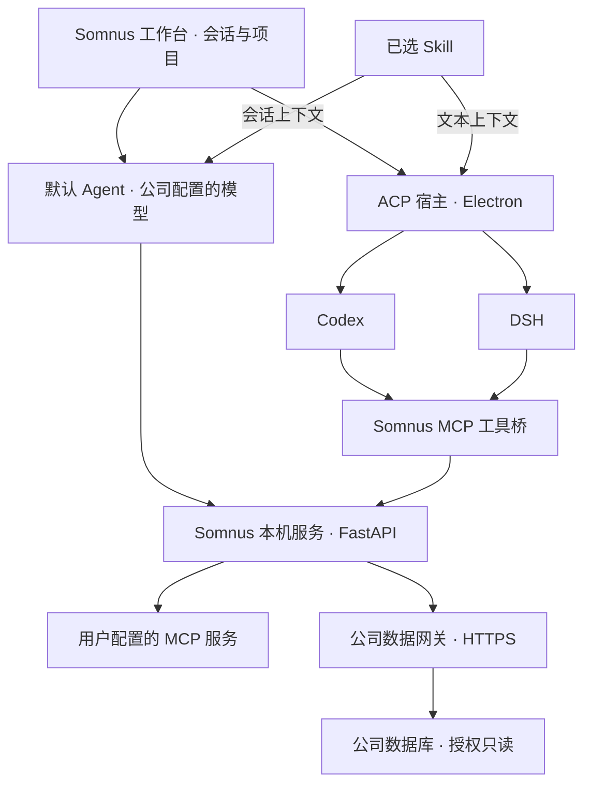

  

<h1 align="center">Somnus</h1>

Somnus 是面向团队的桌面 AI Agent，将会话、本地项目和企业授权数据放在同一个工作台。你可以使用公司配置的默认 Agent，也可以接入自己的 Agent、模型供应商和扩展。

## 核心能力

- **项目会话**　关联本地工作目录，按项目组织聊天。同一会话切换 Agent 时，可带上最近对话和较早内容的摘要。
- **项目协作**　搜索项目文件并审阅修改差异，确认后写入。在支持的桌面 Agent 会话中，可以查看 Git 差异，并在确认后运行已配置的测试。
- **企业数据分析**　连接公司数据网关后，Agent 可按授权查询业务数据，并在配置了分析服务时发起深度分析。

## 技术架构

默认 Agent 直接调用 Somnus 服务。Codex 和 DSH 通过 ACP 接入，在支持 MCP 的会话中使用 Somnus 工具桥调用同一服务。数据库凭据保存在网关侧。

## 扩展生态

用户可配置自己的模型供应商、接入 ACP Agent，或导入 MCP 服务与 Skill。Somnus 可将已选 Skill 作为文本上下文传给外接 Agent。DSH 的兼容 Skill 和插件由 DSH 运行时加载。

## Windows 下载

Windows x64 安装包发布后，从独立公开发布页下载并运行 `Somnus-Setup-<版本>-windows-x64.exe`。目前尚未发布安装包。 [Windows 下载和版本说明](https://github.com/GSXTY/Somnus-Releases/releases)

[维护指南](docs/MAINTAINER.md)
