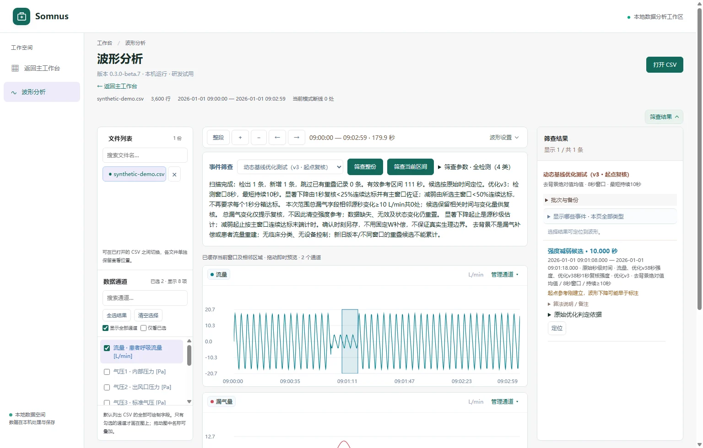

<div align="center">
  

  <h1>Somnus Explorer</h1>

  <p><strong>面向项目协作、公司数据分析和呼吸波形复核的 Windows 桌面工作台。</strong></p>

  <p>
    <a href="https://github.com/GSXTY/Somnus-Releases/releases/tag/v0.3.0-beta.7"></a>
    <a href="https://github.com/GSXTY/Somnus-Releases/releases"></a>
  </p>

  <p>
    <a href="#下载与安装">下载与安装</a> ·
    <a href="#工作台功能">功能</a> ·
    <a href="#典型工作流">工作流</a> ·
    <a href="USER_GUIDE.md">使用说明</a>
  </p>
</div>

Somnus 将项目文件、AI 会话、数据工具和波形复核放在同一个桌面应用中。Windows 版支持按会话选择内置模型或通过 ACP 接入 Codex、DeepSeek Harness 等外部 Agent，也可以在配置中心管理 Skill、MCP 和插件。

## 下载与安装

| 平台 | 下载 | 安装方式 |
| --- | --- | --- |
| **Windows x64** | [Windows 安装包](https://github.com/GSXTY/Somnus-Releases/releases/tag/v0.3.0-beta.7) | 在发布页下载 `Somnus-Setup-*-windows-x64.exe`，安装后从「开始」菜单打开 **Somnus**。 |

更新前，请在系统托盘选择「退出 Somnus」，再运行新版安装程序。Windows 版关闭窗口后会继续在托盘运行。发布页列有更新记录。v0.3.0-beta.7 安装包面向 Windows x64。 [使用说明](USER_GUIDE.md) · [发布历史](https://github.com/GSXTY/Somnus-Releases/releases)

## 工作台预览



<sub>截图使用合成 CSV，展示波形分析和工程候选复核界面。</sub>

## 工作台功能

| 工作区 | 可以做什么 |
| --- | --- |
| **会话与 Agent** | 在项目中保存多条聊天，按会话选择模型或 ACP Agent，查看流式回复、执行过程、上下文占用和模型回传的用量。 |
| **项目与代码** | 授权本机项目目录，搜索和读取文件，创建会话级 Git 工作树，查看差异，审阅 Agent 的修改提案并运行已配置的测试。 |
| **Skill、MCP 与插件** | 在 Somnus 配置中心管理 Skill、MCP 和个人插件，也可管理托管 DeepSeek Harness 的插件。按消息选用能力，工具操作使用当前会话权限。 |
| **公司数据与深度分析** | 查看运营指标，通过授权的数据连接发起只读查询。独立的深度分析试用支持上传 CSV、跟踪任务并查看报告和图表，需要单独配置模型和受限 Docker 环境。 |
| **呼吸波形复核** | 打开本机 CSV，检查流量、压力和漏气，扫描工程候选，人工确认或修改标记，查看历史批次并导出反馈。 |
| **Windows 桌面管理** | 用托盘打开工作台或项目目录，按类别设置任务提醒，切换运行配置。可从独立恢复窗口返回上次可用配置、进入安全模式或导出启动诊断。 |

[会话与工具说明](ai_assistant/README.md) · [深度分析说明](deep_analysis/README.md) · [架构与模块](docs/AGENT_PLATFORM_PLAN.md)

## 典型工作流

### 在项目里和 Agent 协作

1. 在左侧「项目」新建或打开项目，选择要授权的本机目录。
2. 新建会话，选择内置模型或已连接的 ACP Agent。需要时为本轮选用 Skill、MCP 或插件。
3. 检查执行过程和修改提案，应用所需改动，再运行测试。Windows 版可在当前会话开启「完全访问」，每次 PowerShell 调用会显示命令、工作目录和超时供确认。

### 查询数据或复核波形

- 在看板查看运营指标。连接公司数据后，查询范围由已配置的数据源与授权表决定。开发环境可使用合成数据检查指标和视图。
- 在「波形分析」里明确选择一份真实 CSV，选择检测方案并扫描所需区间，逐条复核后按批次导出。
- 需要生成表格分析报告时，在「深度分析」单独上传数据并查看任务状态。

> 自动筛查结果是待人工复核的工程候选，用于研发和工程分析。临床诊断与治疗决策需要相应的专业流程。

## 本机数据与权限

默认 Windows 数据目录为 `%LOCALAPPDATA%\VVFLY\Somnus\`。会话、标记和扫描历史与程序分开保存。新建的运行配置有独立数据目录，切回原配置即可访问其中的记录。

文件、附件和工具结果可能依所选模型与工具配置发送给外部服务。安装包内提供应用组件，账号、密钥和业务数据由使用者在本机配置。本机桌面版面向单操作者。 [数据目录与恢复说明](USER_GUIDE.md) · [模型配置与数据传输说明](ai_assistant/README.md)

## 从源码运行

推荐 Python 3.12、Node.js 24 和 pnpm 11.25.0。以下命令从仓库根目录运行。

```powershell
python -m pip install -r requirements.txt
pnpm --dir page_design/frontend install --frozen-lockfile
pnpm --dir page_design/frontend build
python launcher.py
```

`launcher.py` 启动统一的本机服务，同一地址提供工作台和 `/events` 波形页面。Windows 安装包构建见 [Electron 构建说明](docs/ELECTRON_MIGRATION.md)。已有打包组件时，可运行 `python build_electron.py --dir` 生成本机可运行目录，再启动 `dist/electron/win-unpacked/Somnus.exe`。

## 文档与项目

| 主题 | 文档 |
| --- | --- |
| 安装、恢复与日常使用 | [使用说明](USER_GUIDE.md) · [Electron 构建与迁移](docs/ELECTRON_MIGRATION.md) |
| Agent、模型和工具配置 | [会话与 Agent](ai_assistant/README.md) · [MCP 配置](docs/MCP_CONNECTORS.md) |
| 服务与架构 | [架构与模块](docs/AGENT_PLATFORM_PLAN.md) · [FastAPI 服务](docs/FASTAPI_SERVER.md) |
| 呼吸波形与工程证据 | [检测模块](docs/EVENT_DETECTION_MODULE.md) · [患者流量 v4](docs/PATIENT_FLOW_V4.md) |
| 版本变更 | [更新记录](RELEASE_NOTES.md) · [GitHub 发布页](https://github.com/GSXTY/Somnus-Releases/releases) |

第三方组件按各自许可证分发。本仓库尚未声明公开开源许可证。

[维护与发布](docs/MAINTAINER.md) · [维护控制台](docs/MAINTAINER_ADMIN.md) · [可选 DeepSeek 转发服务](docs/MODEL_RELAY.md)
