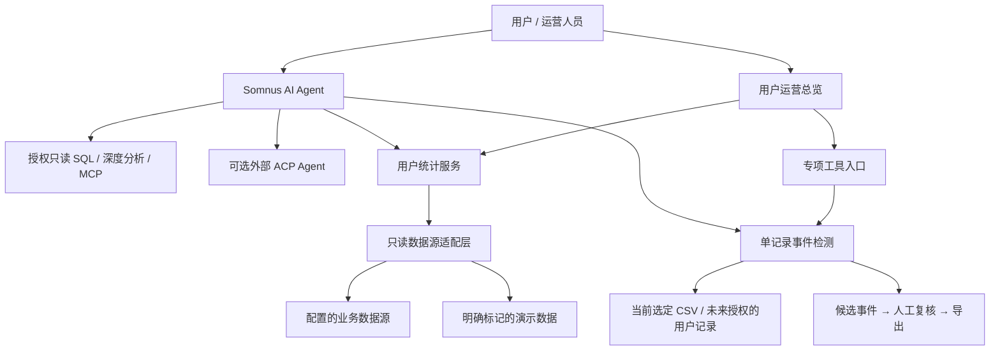

# Somnus 架构、分工与验收

> 当前运行时、统一任务账本与插件边界见 [PLATFORM_RUNTIME.md](PLATFORM_RUNTIME.md)。本文保留业务及迁移历史，不代表当前平台的完整能力规格。

> 深度分析试用更新：新增独立 `deep_analysis/` 模块及同源 `/api/deep-analysis/*`，界面标识为 **DashScope 试用 / DeepAnalyze 协议兼容**，不是已部署的 DeepAnalyze 8B。配置、上传、任务、产物和执行环境与普通聊天分开；默认模型或 Docker 未就绪时明确阻止执行，不自动拉镜像，不在宿主执行生成代码。`isolated` 复用随机浏览器身份隔离所有文件/任务/产物，`shared` 保持本机共享；仍不等于账号权限。

> 服务迁移更新：默认 `launcher.py` 现启动 `server.app` 的 FastAPI / Uvicorn 统一宿主，旧 `event_detection.viewer` 保留为算法/路由兼容边界与回归入口，不再由默认启动器直接监听。部署及 `shared` / `isolated`、单 worker 边界见 [FASTAPI_SERVER.md](FASTAPI_SERVER.md)。数据库日报和每日 CSV 批量任务尚未接入。

> Somnus 是面向项目协作、公司数据查询、深度分析与工程巡检的 AI Agent。已实现 React 巡检工作台、同源事件检测工作区、会话与项目管理，以及授权工具接入。Windows 桌面支持按会话选择模型或外部 ACP Agent。[模型服务说明](../ai_assistant/README.md)

## 产品定位

Somnus 将会话和项目协作与公司数据工具放在同一工作台。看板按数据源显示公司指标或明确标注的合成演示数据。事件检测是本地记录专项工具，提供动态基线 v3、患者流量 v4 和幅度规则等方案，并保留人工复核与历史导出。公司用户与本地波形须经明确绑定和归属验证。

## 模块与专职 Agent

| 角色 | 负责范围 | 当前职责 |
| --- | --- | --- |
| 主 Agent | 需求拆分、调度、验收 | 确认需求和数据口径、分派对应功能 agent、审查证据与验收结果；具体实现交由对应子 agent，不直接承担模块编码 |
| 页面 Agent | `page_design/`、页面导航及必要的纯 HTML 导航衔接 | React 工作台、数据呈现、空态与错误态、响应式布局、入口集成、前端构建与页面测试 |
| 事件检测 Agent | `event_detection/`、检测与接口相关测试 | 患者流量算法、CSV/波形处理、候选保存、复核/批次/导出、检测服务链路与算法回归 |
| 模型服务 Agent | `ai_assistant/`、会话与上游服务测试 | 模型与外部 ACP 会话、SQLite 历史、流式回答、工具权限及结果回传 |
| 深度分析 Agent | `deep_analysis/`、分析任务与受限执行测试 | 独立 DashScope 试用配置、文件、协议工具循环、Docker 受限执行和产物，不复用普通聊天上下文或修改检测算法 |

每项新功能按独立目录和对应功能 agent 维护。主 agent 先明确输入、输出、接口与验收标准再分派；跨模块变更由对应 agent 协调文件所有权，完成实现和测试后提交主 agent 验收。共享入口、统计服务和构建配置的实现也须明确指定责任 agent；不能因处于根目录便默认交给主 agent编码。

上述角色负责代码维护。Somnus 的运行时按会话管理所选模型、外部 ACP Agent、项目上下文和授权工具。

### Somnus 会话与 Agent

会话使用独立 `assistant.sqlite3`，由统一宿主 `/api/assistant/*` 提供。内置 Agent 使用已配置模型，桌面端可添加模型或选择本机外部 ACP Agent。参数齐备与实际连接验证分开显示。密钥由相应的本机或服务端配置管理。

会话支持从列表移除（软删除，保留消息记录且已隐藏会话无法通过API读取）；生成中须先停止。图片可本地粘贴预览，实际发送需服务器显式开启 `AI_ASSISTANT_VISION_ENABLED=true` 并配置支持图片的模型；后端验证PNG/JPEG/WebP格式、大小和尺寸，附件存独立会话库，成功问答以有界多模态上下文发送，失败轮排除。默认图片能力关闭，不会静默丢弃图片按文字发送。

本轮用户输入、选定附件和技能按当前 Agent 的能力组成上下文。公司数据由授权表范围内的只读查询取得，深度分析交给独立任务执行。自定义 MCP 按信任配置与逐次确认规则调用。外部会话重建时可恢复同一会话与同一 Agent 已完成的有限文字问答。

当前为本机单操作者版本，尚无多人会话归属和服务器鉴权。对外部署前须补齐登录与数据访问控制。配置、接口和限制见 [模型服务说明](../ai_assistant/README.md)。

### 工作台与检测入口约定

- 统一通过 `launcher.py` 启动，同一服务提供 React 首页 `/` 与事件检测 `/events`。
- 工具侧栏和工具区从 `/api/plugins` 读取插件入口。“波形分析”以同源 `/events?embedded=1` 嵌入工作台，独立访问 `/events` 仍可用。
- 已随宿主安装的插件可在 `plugin.json` 的 `workspace_entries` 中声明 `id`、`title`、`slot`、`path`、`mode` 和 `access`。`sidebar` 同时显示在工具侧栏和工具区，`tools` 只显示在工具区。独立页面使用 `standalone`、`plugin-managed` 和插件自身已挂载的 `/module/<key>/`；页面可用 `href="/#plugins"` 返回工具区。`access` 描述数据访问范围，实际校验仍由宿主和工具接口执行。
- 检测页侧栏“返回数据大盘”及页头“返回主工作台”链接同源 `/`。动态基线 v3 为检测页默认方案；患者流量优化 v4 和幅度规则可手动选择。
- 工作台合成示例用户与本地 CSV 不自动绑定；入口不携带 `user_id`、`recording_id` 等未经验证的归属参数。必须在检测区明确导入或选择实际记录。
- 页面源码位于 `page_design/frontend/`，生产资源构建到 `page_design/web/`。开发服务器的代理仅用于前端开发；交付和验收使用统一宿主的实际地址。

## 系统结构



当前 `launcher.py` 由 `server.app` 的 FastAPI / Uvicorn 承载统一 HTTP 服务，调用独立 `agent_core.analytics` 统计服务和 `ai_assistant.asgi` 会话路由。`server_detection` 在进程内按请求上下文适配既有 `event_detection.viewer` 检测逻辑，不另开旧监听端口。统计层不依赖检测算法，不从波形缓存推算用户人口；当前适配层仍限定单 worker，数据库日报接入另行实现。

## 总览与指标

- 累计用户：截至所选结束日的去重注册用户。
- 新注册用户：所选日期内注册的去重用户。
- 活跃用户：日期内有有效实际使用区间的去重用户。
- 日均使用时间：所选范围实际使用总分钟数除以活跃用户天数。一个用户使用两天，计两个用户天；不是每次会话时长，也不是除以全部注册用户。
- 注册趋势：按 Asia/Shanghai 自然日显示新增用户。
- 使用趋势：每日实际使用量与活跃用户信息，展示名称和单位与接口对应。
- 用户汇总：注册时间、范围内使用时间、活跃天数。数据库记录尚未映射时显示“记录待接入”，不启用假用户检测。

同一用户重叠使用区间取并集，区间裁剪到日期范围，跨午夜按天拆分。无实际使用数据时平均值为 null。演示数据始终标注合成；默认未连接数据库时指标为未知，不显示伪造零值。

## 单用户 / 单记录检测

当前可用流程：总览旁的检测工具 → 打开单份 CSV → 选择检测方案与范围 → 扫描 → 人工复核 → 导出。当前文件未关联数据库用户，不根据 URL 的 user_id 声称已经绑定。

未来数据库流程：查找用户 → 读取该用户的记录列表 → 选定 recording_id → 校验记录归属与读取权限 → 加载该份记录 → 调用现有算法。输入上下文至少包含 user_id、recording_id、file_id/内容指纹与分析范围；切换记录后旧上下文失效。跨文件、跨用户候选不混合。

运营数据使用真实使用记录；检测数据使用完整原始波形；两者通过明确的用户/记录关联对接。候选是工程筛查结果，需人工复核，不作临床 AHI。

## 主 Agent 的预期任务协议

以下是后续模型接入的设计，本轮没有伪装成已实现的自然语言调度：

| 用户意图 | 范围与必要上下文 | 负责能力 | 输出 |
| --- | --- | --- | --- |
| 查看新增用户、平均使用情况 | 日期范围、时区、可访问人群 | 用户统计服务 | 带来源和口径的统计及趋势 |
| 分析某一用户的使用情况 | user_id、日期、权限、实际使用记录 | 用户统计服务的用户范围扩展 | 用户维度汇总，待后续实现 |
| 检测某份数据 | 已打开 file_id、方案、范围 | 事件检测模块 | 候选及证据，现有流程可用 |
| 检测某一用户的数据 | user_id、已验证归属的 recording_id | 用户记录解析 + 事件检测 | 只分析选定记录；记录映射待数据库接入 |

模型可负责理解意图和解释结果；统计计算、日期处理、记录归属和候选保存由确定的服务执行。不能由模型直接编写并执行任意数据库 SQL，也不能在缺少记录关联时猜测用户文件。只读总览不会触发扫描或写入候选。

## 数据库接入方式

`agent_core.analytics.AnalyticsRepository.snapshot(start_at, end_at)` 返回一致的用户与使用区间快照。用户模型含 user_id、registered_at、display_name；实际使用区间含 user_id、start_at、end_at。时间必须明确时区。适配器必须提供完整人口与区间，不能将一页用户当作总体。

数据库类型确定后再实现相应只读适配器、字段映射、连接配置与用户记录查询。接入时确认设备开关机/实际使用事件口径、重复数据、用户注销处理及访问范围；凭据由服务配置读取，不交给页面。数据量增大时将聚合推到数据库，输出仍遵守接口定义。

## 目录和启动

```text
Data_Agent/
├── 启动AI Agent.cmd / launcher.py  # 统一入口
├── server/                        # FastAPI 应用工厂、启动与会话上下文
├── server_detection/              # 现有检测能力的进程内 ASGI 适配
├── mcp_launcher.py                 # 可选检测 MCP 入口
├── agent_core/                     # 共享协调与统计服务；由指定功能 agent 实现
├── page_design/                    # 页面 Agent 的总览及共用 UI
├── event_detection/                # 检测 Agent 的算法、波形及事件存储
├── tests/                          # 模块与整体回归
├── docs/                           # 架构、接口及检测说明
└── data/                           # 原本机数据，位置不变
```

首页 `/`、`/dashboard`；用户总览 `/api/dashboard`；单份检测 `/events`；本地记录清单 `/api/recording-overview`。原 `/api/open`、`/api/detect`、`/api/events` 等保持检测职责。旧 EXE 不会自动获得源码变化，需重新打包。

## 本轮验收标准

1. 无数据库时首页显示“未连接数据库”和未知指标，不出现波形记录运营指标。
2. 显式演示模式持续标记数据来源，日期筛选改变查询；演示用户不能开启伪造关联的检测。
3. 指标遵守并集、日期裁剪、上海午夜、去重和活跃用户天分母规则。
4. 日期/来源错误给出明确错误，快速切换范围不允许旧响应覆盖新页面。
5. 检测页明确“当前记录”，算法、标记、批次和导出保持原有流程。
6. 打包包含页面本地依赖的正确子目录。只修改源码与打包配置，不自动发布新 EXE。
