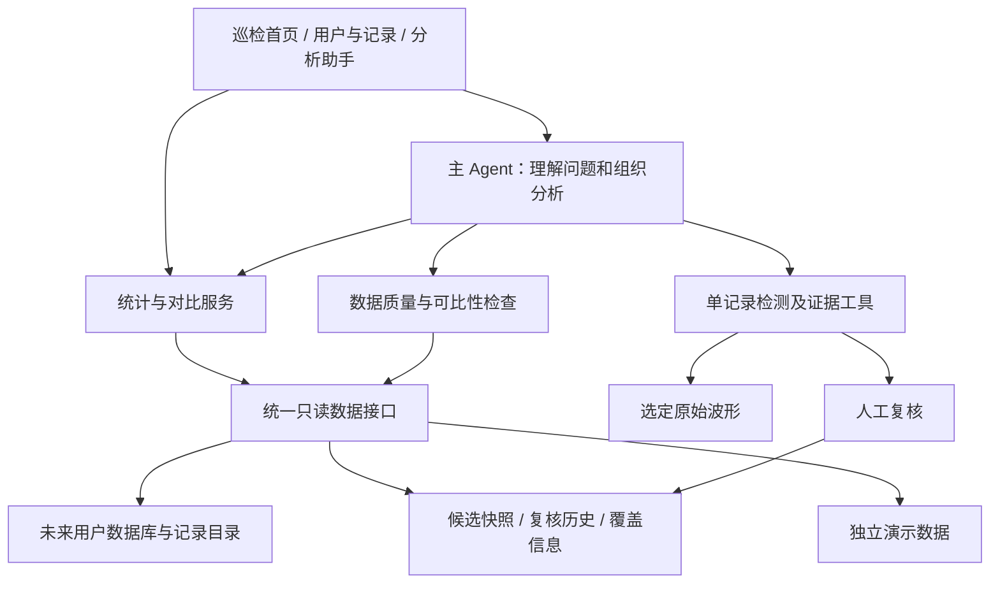

# 内部数据巡检与异常排查 Agent · 第一版建议方案

状态：设计评审稿，待用户确认，尚未实施本方案。2026-11-09。

本文件是本轮设计入口。它在产品定位上更新此前以注册增长为中心的 AGENT_PLATFORM_PLAN.md；已有接口与代码保持现状，不因本文件自动切换。注册量和使用情况仍是次级运营视图。

## 1. 目标和第一版边界

面向内部研发、数据分析与复核人员，帮助回答：哪里发生了变化、变化集中在哪些用户或记录、原始证据是否支持进一步排查。输出“值得检查的线索”，不自动断言变化原因。

第一版形成一个闭环：选择日期和检测口径 → 查看数据覆盖与候选分布 → 按日/用户/记录定位 → 查看波形证据 → 人工复核 → 返回原筛选范围。

建议包含：巡检首页、用户/记录下钻、现有单记录检测和有限问题的分析助手。数据库未定时用明确标注的演示数据评审；真实用户映射未接入时，仅开放本地记录分析。自动归因、预测、大范围自动重扫、后台定时告警和自动报告留到后续，不在第一版默认启用。

## 2. 系统架构

建议运行时采用一个主 Agent 调用确定的专业工具。统计、归属校验和候选写入不由模型自由生成；不要求每项能力先部署一个独立大模型。开发协作仍按功能 agent、独立聊天和目录组织。

| 负责人 | 本轮交付 | 目录 / 文件 |
| --- | --- | --- |
| 主 Agent | 总体架构、统计口径、数据能力边界、跨模块验收 | 本文件、未来 agent_core/ |
| 页面 Agent · 页面设计 · 数据总览 | 导航、页面文字线框、筛选下钻、状态与验收 | [页面设计](../page_design/PATROL_PAGE_DESIGN.md) |
| 检测 Agent · 事件检测 · 功能维护 | 记录上下文、代表批次、覆盖、证据与复核设计 | [检测设计](../event_detection/PATROL_DETECTION_DESIGN.md) |

第一阶段由主 Agent 统筹统计与数据质量设计；确定数据库和开发范围后，再决定是否增加专职数据接入 agent。本轮不额外创建聊天或目录。

## 3. 信息结构与闭环

建议主要入口为“巡检总览、数据记录、用户查询、运营概况、单份本地检测”。用户查询在真实归属映射接入后启用；分析助手以携带当前筛选的侧栏提供，避免脱离上下文。数据来源、口径和更新时间先在总览与详情可见，后续复杂配置再独立为数据管理。注册/活跃/实际使用趋势归入次级运营概况。

巡检总览从上到下：

1. 日期、用户范围、事件类型、方案与参数、数据来源筛选。
2. 数据新鲜度及覆盖摘要：已到达记录、已扫描记录、有效分析小时、归属未知/质量不可用部分。
3. 候选规模、候选密度、涉及用户、人工复核进度；未知值保留未知。
4. 每日数量/密度趋势，旁列暴露时长，避免将记录增多误看成候选风险上升。
5. 待排查线索：变化集中在哪天、哪些用户/记录，以及证据入口。

事项点开保留查询上下文，先列出贡献记录，再跳至某份记录的事件和波形。离开复核页返回时恢复筛选与列表位置。重新扫描不悄悄改写原分析结果，而是生成新结果供显式刷新。

## 4. 第一版统计口径建议

以下是建议口径，需与实际数据一起确认后开发。它们不是当前软件已支持的跨用户统计。

| 指标 | 建议定义 | 必须展示的限制 |
| --- | --- | --- |
| 自动候选数 | 来自明确选定代表批次、事件类型及时间范围的原始候选 | 不把所有历史扫描相加；不冒充独立临床事件 |
| 每有效分析小时候选数 | 可纳入候选数 / 相应有效分析小时 | 是工程候选密度，不是临床 AHI；分母未知或为零则未知 |
| 涉及用户数 / 占比 | 范围内至少有该类候选的去重用户 / 已关联且该类型覆盖可用的用户 | 同时给分子分母；归属未知不混入用户人数 |
| 候选累计覆盖时长 | 选定类型候选区间并集，裁剪到日期边界后累计 | 同一记录重叠区间不重复累加；跨类型总计也需并集 |
| 复核情况 | 对当前选定候选可追溯的待复核、确认、忽略、无法关联数 | 逐条复核不代表全区间正常；忽略率不是准确率 |

### 有效分析时长

区分四种时间：记录首尾跨度、实际使用时长、成功扫描范围、算法可用分析范围。它们不能互相替代。

建议有效分析区间为“所选日期 ∩ 代表扫描覆盖 ∩ 对应事件类型的算法可用区间”，去除缺失、无效样本、基线不足等不具备判定条件的部分，再做并集。不同事件类型可能分母不同。质量事件单列，不把排除后的时长作为其密度分母。

当前候选数据若缺少算法有效区间、时钟依据或成功覆盖证明，仅显示有依据的数量与跨度说明，候选密度标为“不可计算”，不能从首尾时间估造。数据覆盖率还需要独立可追溯的应分析记录范围；应有数据量未知时不显示“100%”。

### 代表批次和复核版本

同一记录、同一方案/算法版本/方法/窗口/持续门限/输入/事件类型组成统计口径。第一版建议由用户选定口径，每条记录仅使用一个覆盖满足要求的成功批次；默认候选可为最近成功的同口径完整批次，但必须显示选用规则和实际批次。没有完整批次则明确部分覆盖，不拼凑多次扫描后声称完整。

原始候选数量与人工复核后的结果分开。保留分析快照引用的 run_id 和 review revision；修改类型、边界、拆分或合并后仍能追溯原候选。不能把同一个人工标记重复归入多个自动批次。无法建立对应关系时标记未知，不默认待复核。

### 按日与重叠记录

建议上海自然日统计：数量归到事件开始日，持续时间按与每天的重叠部分拆分。跨午夜事件在次日可以有持续时间但无新增候选，页面说明此区别。范围外开始、范围内仍持续的候选保留为边界延续项，不遗漏其时长，不增加范围内开始数。

相同用户、相同内容指纹的重复导入不重复统计。同一用户不同文件但时间重叠时，必须有记录优先级/片段映射才能合并；第一版无法裁定则标记冲突、退出密度对比并列出影响范围。内容指纹相同但用户归属冲突时先核实，不按指纹跨用户自动合并。

## 5. 从“高数量”到“可解释的变化线索”

建议第一版先做描述性对比，而非自动认定异常。默认方案可采用近 7 天查看、紧邻的前 7 天作为对照，均可修改；只在相同算法口径下比较。较长历史基线及同星期匹配留作后续规则评审，不能在历史不足时补造参考值。

对照密度应使用对照期候选总数 / 对照期有效分析总小时，不对每日比值做简单平均。展示本期与对照期的数量、密度、有效小时和纳入用户数。基期为零时不显示“增长无穷大”，改为“基期为零”并展示绝对变化。

初步支持三类线索：候选密度变化、某些用户/记录贡献集中、数据质量或覆盖变化。用户自身历史与群体对照分开，不能将一个新用户与有长期历史的用户混为同一风险排序。

说明性例子（不是实际数据）：本期 120 条候选 / 60 个有效小时，上期 60 条 / 30 个有效小时，两期密度都是 2 条/小时。助手应解释“原始数量增加，现有数据未显示密度增加”，并让人员核查记录覆盖和用户构成，不能仅凭数量翻倍生成异常结论。

没有足够历史、有效分析时长太少、用户构成变化、配置不同或质量明显不同，标记“数据不足/不可直接比较”。最低暴露时长、最少对照天数、同星期匹配及触发阈值留作待确认参数；未设置前不产出自动异常标签，不宣称统计显著。

事项可按变化幅度或候选密度排序，界面同时展示样本量与限制；排序是排查顺序，不是用户健康/风险分级。不可比记录另列，不被静默隐藏。

## 6. 数据对象与数据库接入建议

| 概念对象 | 最小信息 | 用途 |
| --- | --- | --- |
| 用户 / 设备 | 稳定标识、明确的关联及生效时间；可选设备型号/固件 | 用户去重、分组和记录归属 |
| 数据记录 | recording_id、用户关联、内容指纹、起止时间与时区、可访问原始数据引用 | 下钻和去重；文件名不是归属证明 |
| 扫描批次 | run_id、记录、方案版本及参数、事件类型、覆盖、完成状态、创建时间 | 确定代表批次和可比口径 |
| 候选 / 复核 | 原始候选标识及证据、复核版本、状态、修改对应关系 | 原结果稳定与复核追溯 |
| 覆盖与质量 | 原始/有效区间、排除原因、时钟可信度及依据版本 | 可用分母、数据不足说明 |
| 分析快照 / 线索 | 查询范围、纳入对象、批次及复核版本、口径版本、数据时间、证据引用 | 刷新前后可解释、从结论返回原始数据 |

以上是概念模型，不强制数据库表名或技术选型。现有只读用户/使用区间接口可以保留用于运营指标，但不足以支撑巡检；需补记录、扫描覆盖、候选与复核的只读查询能力。生产汇总需完整人群/一致快照，不能拿一页记录当总体。

本地文件无真实用户映射时只显示记录级统计。未连接、未扫描、已扫描零候选、覆盖不足、配置不可比、归属未知、演示是不同状态。数据源故障不解释为零候选。

## 7. 主 Agent 与工具边界

建议首批支持三个问法：“某天哪些记录候选较集中”“某用户本周与自身历史有何变化”“这批变化能否直接比较”。上下文不完整时先补日期/口径/目标，不默默跨用户或跨版本求和。

| 预期工具 | 职责 | 行为边界 |
| --- | --- | --- |
| 查询覆盖、汇总候选、对比范围 | 返回确定计算值、分母、限制与来源 | 只读；不暗中重扫 |
| 列用户记录、读取事件证据 | 验证归属，定位可访问记录与波形 | 不因 URL 传参就信任用户归属 |
| 执行选定记录检测 | 复用现有算法并形成新批次 | 目标、范围、配置需明确；大范围扫描另行设计 |
| 保存人工复核 | 执行已明确的人工操作，保留变更历史 | 不将 Agent 的解释自动写成已确认事件 |

每次分析回答包含“观察结果、比较依据、样本/覆盖、限制、证据入口、建议下一步”。模型不创造数值、不自由执行任意 SQL、不把相关性写成因果。当前尚未接大模型调度，不将文档中的工具列为已运行功能。

## 8. 分阶段实施与评审决定

1. 本轮：三个 agent 交付设计并由主 Agent 对齐；只更改设计文档。
2. 用户确认后：先实现演示巡检闭环、覆盖/批次/归属状态与可解释指标，不连未知数据库。
3. 数据库信息齐备后：接只读适配器、真实用户记录映射与覆盖证据，按真实样例验收。
4. 再接有限问题的对话调用，之后考虑提醒、批量任务和报告。

建议用户下一次确认的重点：第一版闭环范围；首页以候选巡检为主、运营为辅；代表批次与按日计数建议；描述性对比优先于自动告警。具体模型、数据库品牌和阈值可在真实数据与业务口径明确后选，不阻塞这轮设计评审。

## 9. 主 Agent 验收清单

- 相同内容重复导入/重复扫描不重复累计；不同算法或参数不自动混合。
- 已扫描零候选与未扫描/数据源故障明确不同；未知不能变为零。
- 缺少有效覆盖或应分析范围时不伪造密度与覆盖率。
- 跨午夜和部分扫描有明确、可追溯的计数/时长规则。
- 用户与文件映射未验证时不展示虚假用户分析或绑定跳转。
- 每条线索可以下钻到所选记录、批次、事件及波形，复核后保留原分析上下文。
- 历史不足、基期零、短暴露及配置不同有对应展示，不输出伪造异常结论。
- 自动候选与人工确认分开；逐条复核不等于完整检查，忽略率不冒充准确率。
- 演示模式持续有标识；真实数据接入失败不回退成未标记的演示。
- 不因只读总览、对话查询或排序触发重扫与写入。

## 10. 本轮设计整合结论

主 Agent 已阅读页面与检测两个分案并对齐：默认查看近 7 天、前一期等长对照；助手采用上下文侧栏；原始候选数量与复核结果分开；只有有效区间与时钟依据验收后才显示密度；重复内容仅在身份与归属明确时去重；未绑定用户只能记录级分析。按事件起点归日是本方案的建议，前端应使用服务返回结果，不能自行实现不同规则。

检测分案提出的“先不提供归一化事件率”与主方案的条件式密度展示并不要求提前实现分母：第一阶段缺少有效区间时显示不可计算；后续补齐并验收后才启用。界面不得为填满指标卡估算分母。

本轮交付为三份设计及旧规划的入口提示，未按新方案修改业务代码、页面、算法、数据库或运行测试。文档评审完成不代表功能验收通过；下一步由用户确定开发范围后再拆分实现任务。
